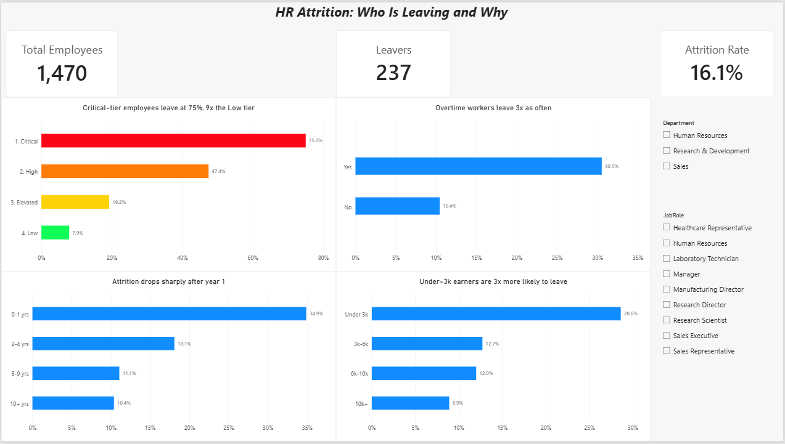
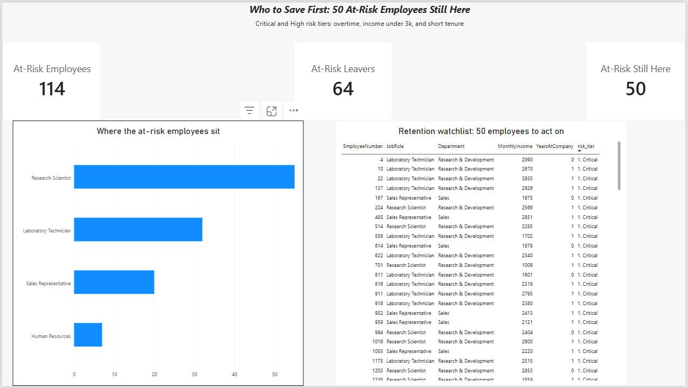

# HR Attrition & Workforce Analytics

**Question:** Who is leaving, why, and what does it cost?

**Answer:** 114 employees (8% of the workforce) are at critical or high risk. 64 have already left. The 50 still here are worth about 209K in avoided replacement cost if 30% of them are retained.

## Dashboard



## Key findings
- Overall attrition: 16.1% (237 of 1,470 employees)
- Overtime workers leave at 30.5% vs 10.4% (chi-square p < 0.001)
- First-year employees leave at 34.9%; 10+ year employees at 10.4%
- Employees earning under 3k/month leave at 28.6% vs 8.9% for 10k+
- Attrition comes from combinations of factors: no single numeric variable has a correlation stronger than about 0.17

## Risk tiers
| Tier | Rule | Employees | Attrition |
|---|---|---|---|
| Critical | Overtime + income < 3k + tenure < 2 yrs | 36 | 75.0% |
| High | Overtime + income < 3k | 78 | 47.4% |
| Elevated | Overtime or income < 3k | 583 | 19.2% |
| Low | Neither | 773 | 7.9% |

## Recommendation
Focus retention on the 50 Critical/High employees still here, mainly Research Scientists, Lab Technicians and Sales Representatives. Reduce forced overtime and review pay for roles under 3k/month. At an assumed replacement cost of 50% of annual salary and a 30% retention success rate, this avoids about 209K in turnover cost.

## Tools
MySQL (segmentation, views) · Python (pandas, seaborn, scipy) · Power BI (2-page dashboard) · Excel (cost calculator)

## Project structure
```
hr-attrition-workforce-analytics/
├─ data/          raw_hr.csv, clean_hr.csv
├─ notebooks/     01_cleaning.py, 02_eda
├─ sql/           01_create_table to 06_cost_inputs
├─ powerbi/       hr_attrition.pbix
├─ excel/         cost_of_attrition.xlsx
├─ figures/       charts and dashboard screenshots
└─ README.md
```

## Assumptions
Replacement cost (50% of annual salary) and retention success (30%) are adjustable inputs in `excel/cost_of_attrition.xlsx`. The dataset has no currency, so costs are in currency units.

## Dataset
IBM HR Analytics Employee Attrition & Performance (Kaggle). Public, fictional data.